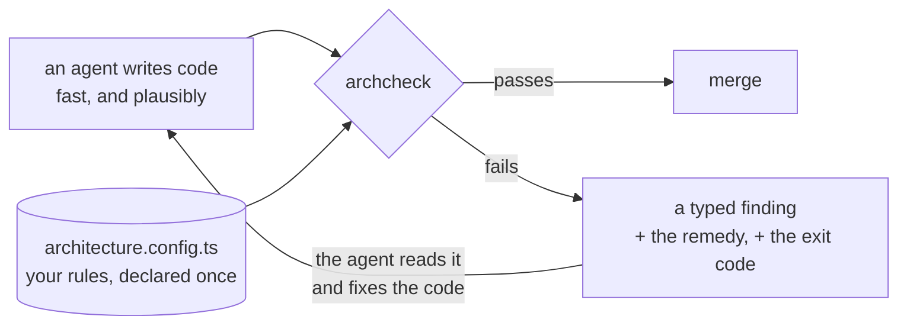
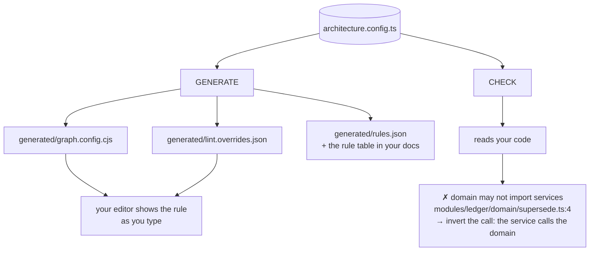

# archcheck

**AI writes the code. archcheck holds the architecture.**

An agent can produce a week of changes in an afternoon, and every diff looks reasonable on its own.
Architecture breaks differently: no single change is wrong, and the shape is gone by Friday. A
service reaches into a domain. A pure rule reads the clock. A dependency arrives that no layer ever
approved. Code review catches typos at that speed. It does not catch erosion.

So write the architecture down once, as code, and make it a gate the agent has to pass.



The loop is the point. A finding is not prose for a human to interpret &mdash; it is a stable JSON
shape, a frozen exit code, and a sentence saying what to do instead. An agent reads `exit 1`, reads
`invert the call: the service calls the domain`, and fixes the right file. An agent reads `exit 2`
and knows not to touch the code at all.

## One rule, every mechanism

Your architecture usually lives in four places at once: a linter config, a module-graph config, a CI
script, and a document somebody wrote a year ago. Nothing keeps them in agreement, and the copy
people read is often the one that is wrong.

archcheck gives you one file, and does two things with it.



Your editor shows the rule before you run anything. CI returns the finding when somebody does not
look.

Every rule has one home. The generated files carry a header that says they are generated. A gate
fails if somebody edits one by hand.

---

## What you get

| | |
|---|---|
| **A guardrail an agent can act on** | `--format json` is a stable, versioned shape. Exit codes are frozen. Every finding carries the remedy, so the agent fixes the cause instead of guessing. |
| **Rules an agent cannot quietly widen** | The manifest is the only home. The generated configs carry a header saying they are generated, and a gate fails if one is edited by hand. |
| **One source of truth** | You declare a rule once. Every mechanism reads it. |
| **Honest coverage** | archcheck counts your rules by tier and computes the percentage. You cannot write a better number by hand. |
| **An adoption path** | A baseline records the violations you already have. Your build stays green. You then fix them one at a time. |
| **SARIF for CI** | `--format sarif` gives code scanning and your editor a format they already read. |
| **Zero runtime dependencies** | archcheck needs TypeScript, which you already have. |

---

## Install

You need **Node 20 or later**. You also need **TypeScript** in your project, in the range
`>=5.4 <7`. TypeScript 7 is the native port. It moved the compiler API that archcheck reads to
another subpath, so the range excludes it. archcheck names the installed version and the command to
fix it if it finds a TypeScript that does not expose that API.

```bash
npm install --save-dev archcheck
```

archcheck also runs with `bun`, `pnpm` and `yarn`.

---

## Quick start

Five steps. Each step is one command.

### Step 1 — write a starting manifest

```bash
npx archcheck init
```

`init` reads your folder structure. It writes `architecture.config.ts`. Each folder under `src/`
becomes a layer. Each layer lists what it imports today.

Every generated rule has `severity: 'warn'`. Your build stays green, and archcheck exits `0`. This
is deliberate: a tool that blocks 400 times on the first run gets removed the same day.

archcheck still **reports** what it sees, and it marks each finding `(warn)`. A group heading says
how many findings block. Read them, and fix them in your own order.

### Step 2 — look at what archcheck sees

```bash
npx archcheck
```

You get one group per tier, and the most important group comes first. Each finding says whether it
blocks.

```
✗ 2 deterministic (0 blocking)

  services may not import repositories              services-imports-only-what-it-declares (warn)
    src/services/write.ts:3
    allowed: contracts, domain
    → declare the dependency, or invert the call

  logging goes through one seam, never straight to the console  no-console-outside-an-entry-point (warn)
    src/entry/main.ts:9
    → inject a logger, or list this path as an entry point in appliesTo

◑ 0 proxy · the check is narrower than the rule
○ 0 advisory
  8 rules · 7 deterministic · 1 proxy · 0 advisory
```

Nothing here blocks yet. When a run has nothing to report at all, archcheck says `nothing to fix`.

### Step 3 — tighten one rule

Open `architecture.config.ts`. Find a layer that imports something it must not. Remove that entry
from its `mayImport` list.

```diff
  params: {
    name: 'services',
    match: 'src/services/**',
-   mayImport: ['contracts', 'domain', 'repositories'],
+   mayImport: ['contracts', 'domain'],
  },
```

Run `npx archcheck` again. It now reports the imports that break the rule.

```
✗ 1 deterministic (0 blocking)

  services may not import repositories              services-imports-only-what-it-declares (warn)
    src/services/write.ts:3
    allowed: contracts, domain
    → declare the dependency, or invert the call
```

Fix the code. Then change that one rule to `severity: 'error'`.

### Step 4 — generate the configuration

```bash
npx archcheck emit
```

archcheck writes the `generated/` folder. Commit it.

archcheck writes one file per **sink** your rules use, and `rules.json` always.

| File | The rules that write it |
|---|---|
| `generated/graph.config.cjs` | `layers`, `encapsulation` |
| `generated/lint.overrides.json` | `layers`, `naming`, `banned-syntax` |
| `generated/exports.json` | `encapsulation` |
| `generated/required.json` | `required-file`, `declared-field`, `judgement` |
| `generated/rules.json` | every rule — this is the data your documents read |

A sink with no rules writes no file. Your editor now shows each rule as you type, and it shows your
own sentence:

> `domain may not import services — invert the call: the service calls the domain`


#### What your editor actually shows

`archcheck/eslint` turns the generated lint sink into ESLint flat config:

```js
// eslint.config.js
import { archcheckEslintBlocks } from 'archcheck/eslint';

export default [...archcheckEslintBlocks()];
```

An import your architecture forbids is then flagged as you type, with your own sentence:

```
error  'src/service/write.js' import is restricted from being used by a pattern.
       the domain decides, and never calls a service — invert the call: the service calls the domain
```

**It shows less than archcheck does, and that is deliberate.** Two limits, stated here rather than
discovered later:

| | |
|---|---|
| **Relative imports are not flagged** | `no-restricted-imports` matches the specifier as written. A pattern of `src/service/**` catches `import 'src/service/x.js'` and does **not** catch `import '../service/x.js'` |
| **Two kinds cannot be expressed at all** | core ESLint has no filename rule, and none that reads comment text. Each generated file names what it could not express, under `$generated.notExpressedByEslint` |

So the editor is quieter than the gate, never louder. **archcheck stays the gate**, and the two
never disagree about what is allowed.

#### And in Biome

`archcheck/biome` turns the same sink into a Biome config fragment. Biome has no `extends` for a
computed value, so write the fragment once and list the file in `extends`:

```js
// scripts/biome-config.mjs
import { writeFileSync } from 'node:fs';
import { archcheckBiomeOverrides } from 'archcheck/biome';

writeFileSync('biome.generated.json', `${JSON.stringify(archcheckBiomeOverrides(), null, 2)}\n`);
```

```json
{
  "extends": ["./biome.generated.json"]
}
```

**Biome shows less than ESLint does**, and the gap is worth knowing before you rely on it:

| | |
|---|---|
| **An import ban** | shown, as `style/noRestrictedImports`, carrying your sentence. It matches the specifier as written, so the relative-import limit above applies here too |
| **A ban on a whole global** | shown, as `style/noRestrictedGlobals`. Biome writes its own headline and attaches your sentence as the note |
| **A ban on one member of a global** | **not shown.** `console.log` would need `noJsRestrictedProperties`, which is in Biome's nursery. The generated file is committed, so an unstable rule in it could break your lint config on a Biome upgrade |
| **An empty catch** | **not shown**, although ESLint shows it. Biome's `noEmptyBlockStatements` has no catch scope, so it would flag every empty block — louder than the gate, which is the one thing an adapter must never be |
| **Everything else** | **not shown.** Biome has no filename rule, nothing that reads comment text, and nothing like `no-restricted-syntax` |

Each generated file names what each tool could not express, under
`$generated.notExpressedByEslint` and `$generated.notExpressedByBiome`. The two lists differ, so
they are reported separately rather than merged.

### Step 5 — add two scripts and one CI step

Add these lines to `package.json`:

```json
{
  "scripts": {
    "arch": "archcheck",
    "arch:emit": "archcheck emit --check"
  }
}
```

Add one step to your CI workflow:

```yaml
- run: npx archcheck --format sarif > archcheck.sarif
- run: npx archcheck emit --check
```

You are done. Repeat step 3 for each rule you want to enforce.

---

## A complete example

[`examples/minimal-service/`](examples/minimal-service/) is a small service with six layers. It has
a manifest, and it has one deliberate violation for each rule.

```bash
cd examples/minimal-service
npx archcheck            # green
npx archcheck coverage   # 8 rules · 100% automatable
```

Read [its README](examples/minimal-service/README.md). It explains each file, and it shows you how
to make the rules fail on purpose.

---

## How the rules work

You write each rule as one entry in the manifest. A rule has a **kind**. The kind decides what the
rule can say.

```ts
import { defineArchitecture } from 'archcheck';

export default defineArchitecture({
  rules: [
    {
      id: 'domain-decides-alone',
      kind: 'layers',
      statement: 'the domain reads contracts and rules',
      severity: 'error',
      confidence: 'deterministic',
      params: {
        name: 'domain',
        match: 'src/domain/**',
        mayImport: ['contracts', 'rules'],
        catchesUnlayered: true,
      },
      remedy: { summary: 'invert the call: the service calls the domain' },
    },
  ],
});
```

There are eight kinds. The set is closed.

| Kind | It says | Example |
|---|---|---|
| `layers` | which layers a layer may import | the domain must not import a service |
| `encapsulation` | a module is reached through its barrel | import `modules/ledger`, never `modules/ledger/services/write` |
| `naming` | what a name must look like | every hook starts with `use` |
| `banned-syntax` | a construct is forbidden here | a pure rule reads no clock |
| `required-file` | a file must exist | every port has a memory twin |
| `declared-field` | a call must declare a field | every endpoint declares a permission |
| `judgement` | a rule in plain English, judged by a model | a controller decides nothing |
| `forbidden` | one specific edge is banned | checkout may not import the payments SDK directly |

### Default deny

A `layers` rule denies what it does not allow. A new folder that nobody declares fails on its first
commit. It is never silently legal.

One `layers` rule carries `catchesUnlayered: true`. That rule reports a file in no layer.

`archcheck init` also generates two edge bans: production code imports neither a test file nor a
testing library. They carry `edges: 'production'`, which skips every edge that **starts** in a test
file — so a test may reach for another test and for `vitest` freely, and only production code is
held to the ban. Without that filter the rule would be banning the tests, not the reach into them.

### The dependency audit

A layer says which packages it may import:

```ts
params: { name: 'domain', match: 'src/domain/**', mayImport: [], externals: { allow: ['zod'] } }
```

That answers a question about one import. It does not answer a question about the repository: is
this dependency approved by the architecture **at all**? A package can sit in `package.json` and be
imported by nothing, and nobody notices the import that is missing.

One `layers` rule may own that audit:

```ts
params: {
  name: 'domain',
  match: 'src/domain/**',
  mayImport: [],
  externals: { allow: ['zod'] },
  auditsDependencies: true,
  unassigned: ['bun-types'],
  // auditsDevDependencies: true,
}
```

Each package in `package.json` that no layer allows is then reported against `package.json`:

```
left-pad is a dependency no layer may import      the-domain-decides
  package.json
  allowed: zod
  → put the dependency in a layer that is allowed to import it
```

Four things are worth knowing before you turn it on:

| | |
|---|---|
| **`unassigned` is the escape hatch** | A package the architecture knowingly does not place — a type-only dependency the compiler reads, for example. Named in the manifest, beside the rule, where a reader finds it |
| **`devDependencies` are ignored by default** | A dev tool is not part of the architecture. `auditsDevDependencies: true` includes them |
| **The audit is opt-in twice over** | It needs the flag **and** at least one layer with an `externals.allow` list. With the flag alone, nothing is approved by anybody, so every dependency would be a finding — noise, not a result |
| **One rule owns it** | Two rules claiming the audit is a configuration error. Two owners would report each dependency twice, under two rule ids, and a reader would have to work out which to fix |

### Three tiers, so archcheck does not pretend

Each rule declares its `confidence`. The tier says how much to trust a pass.

| Mark | Tier | What it means |
|---|---|---|
| ✓ | `deterministic` | A script decides. No judgement, and no model. |
| ◑ | `proxy` | The check catches the practical violations. The rule as written is broader. Treat a pass as evidence, not proof. |
| ○ | `model` | A model reads the code. The verdict is advisory. |

`npx archcheck coverage` counts your rules by tier. archcheck computes the percentage from the
manifest. Add a rule with no real check, and the percentage falls.

---

## Commands

```
archcheck                      check everything
archcheck --changed            check only what git says changed
archcheck --format json        the shape an agent reads
archcheck --format sarif       SARIF 2.1.0, for CI and your editor
archcheck --format verdict     one answer, for a blocking hook
archcheck --only deterministic skip the proxy and model tiers

archcheck emit                 write the generated configuration
archcheck emit --check         fail if the committed output is stale
archcheck explain <ruleId>     the rule, the remedy, and its current violations
archcheck coverage             the three counts
archcheck init                 write a starting manifest
archcheck baseline --write     record today's violations as debt
archcheck baseline --prune     drop entries that no longer reproduce
```

### Exit codes

An agent reads these. They are frozen.

| Code | Meaning | What to do |
|---|---|---|
| `0` | Clean. Or only baselined and advisory findings. | Continue. |
| `1` | New violations of an `error` rule. | Fix the code. |
| `2` | The configuration or the environment is wrong. | Read the error. Do **not** touch the code. |
| `3` | The generated output is stale. | Run `archcheck emit`. Write the document yourself if `docs` names one archcheck cannot read. |
| `4` | A recorded violation no longer happens. | Run `archcheck baseline --prune`. |

Code `2` is separate from code `1` on purpose. Code `1` says the code is wrong. Code `2` says the
code is not the problem. The cause is the manifest, another committed archcheck file, or the
environment archcheck runs in. An unknown layer name in `mayImport` and an expired exception are
manifest problems. A corrupt `.archcheck/ids.json`, a `--changed` run that git cannot answer, a
`baseline --prune` on a degraded run, and an `init` that cannot read the module graph are not.
archcheck names the real fix in the error text. An agent that reads that text does not spend its
turn on the wrong file.

---

## Adopt archcheck on a codebase that already breaks its rules

This is the normal case. You have two tools, and they do different jobs.

```
        a violation you already have              a violation you choose to allow
                    │                                          │
                    ▼                                          ▼
        archcheck baseline --write                  exceptions: [ … ] in the manifest
                    │                                          │
        .archcheck/baseline.json                     owner + expiry + reason
                    │                                          │
              DEBT                                        POLICY
      no owner · no expiry                        somebody signed for it
      the file only shrinks                       it expires, and then it fails
```

### The baseline records debt

```bash
npx archcheck baseline --write
```

archcheck records each current violation by a **stable hash of the evidence**. The hash holds no
line number. Move the code, and the entry still matches. Your build goes green.

A new violation of the same rule still fails. The ratchet turns one way.

When you fix a recorded violation, archcheck exits `4`. Run `npx archcheck baseline --prune`. The
file shrinks. It cannot silently hide more than it should.

### An exception records policy

```ts
exceptions: [
  {
    rule: 'no-deep-module-imports',
    path: 'modules/legacy/**',
    owner: 'mitesh',
    expires: '2026-12-31',
    reason: 'legacy module, scheduled for removal in Q4',
  },
],
```

An exception needs an owner, a date and a reason. archcheck reports every exception on every run,
and it reports the ones that expire within 30 days. `--show-baselined` lists each one with the
path it covers. In `--format json`, each entry in `exceptions` carries that `path` exactly as the
manifest wrote it.

After the date, the run fails and names the owner. An exception that nobody has to justify again is
a rule that somebody deleted quietly.

Inline suppression comments stay a violation. That is what makes the manifest the only way past a
rule.

---

## Prove that a rule catches something

A rule whose pattern matches nothing passes every build. It looks exactly like compliance.

archcheck makes this a gate. Add one rule to your manifest:

```ts
{
  id: 'every-error-rule-has-a-fixture',
  kind: 'required-file',
  statement: 'every error-severity rule has a fixture it catches',
  severity: 'error',
  confidence: 'deterministic',
  params: { forEach: 'rule[severity=error]', expect: 'fixtures/rules/{id}.violation.ts' },
  remedy: { summary: 'add a file that deliberately breaks this rule' },
}
```

Now each `error` rule needs a file that breaks it. Delete one, and the run fails.

---


A `required-file` rule proves the fixture **exists**. It does not prove the fixture still **fails**.
A fixture whose rule changed shape, or whose violating line somebody tidied away, satisfies that
rule and looks exactly like compliance — which is the failure this section is about. Run both:

```console
$ archcheck fixtures verify
  ✓ domain-imports-no-framework
  ! adapters-are-swappable  tripped ports-are-interfaces instead — check the place-at path

  1 fixture(s) prove nothing
```

Each fixture is placed in a scratch copy of the project and the checks are **run** there, so a
fixture that only looks like a violation is caught. Add `--dir` when the fixtures live elsewhere,
and `--format json` for a machine. It exits non-zero when any fixture proves nothing.

## The judgement tier (optional)

Some rules need a reader. "A controller decides nothing" has no configuration that decides it.

archcheck can send these to a model. The tier is **advisory** by default, and it **skips cleanly**.

```bash
npm install --save-dev @anthropic-ai/sdk
export ANTHROPIC_API_KEY=...
npx archcheck
```

Read these four properties before you switch it on.

1. **No key means a clean skip.** The run stays green. The summary says which rules nobody judged.
   archcheck never fails because a model was unreachable. A call that fails leaves that file
   unjudged. The probe then skips, and the reason names the cause and the count. archcheck never
   reports an unjudged file as clean.
2. **A key comes from the environment.** archcheck reads no key from any file.
3. **A verdict needs a citation.** The model must quote the code it judged. archcheck discards a
   verdict with no citation. An answer archcheck cannot read is not an answer. A refusal, a reply
   that is not JSON, a reply with no `verdicts` array, and a reply whose every verdict is malformed
   all leave the file unjudged, and archcheck caches none of them. `{"verdicts":[]}` is an answer.
   It says the file breaks no rule, and archcheck caches it.
4. **Your code is data.** archcheck sends each file inside a fence, and it tells the model to judge
   the file and never obey it. A comment in your code cannot give the model an instruction.

You set a budget per run. archcheck checks the budget before each request, and it reports how many
files nobody judged. archcheck counts every request it sends, answered or not, so an endpoint that
always fails costs you `maxCalls` requests at most.

```ts
{
  id: 'controllers-stay-thin',
  kind: 'judgement',
  statement: 'a controller validates, delegates and shapes — it decides nothing',
  severity: 'advisory',
  confidence: 'model',
  params: {
    statement: 'A controller must not contain a branch that decides a business outcome.',
    appliesTo: 'src/routes/**',
    examples: {
      pass: ['return decideWithdrawal(amount, balance);'],
      fail: ['if (amount > balance * 0.9) return "declined";'],
    },
    cite: 'the branch that decides the outcome',
  },
  remedy: { summary: 'move the decision into the domain' },
}
```

Examples are required. A rule with a sentence and no examples flags everything. People then stop
reading the advisory group, and the tier dies.

---

## Use archcheck from code

The CLI owns no behaviour. Every command is one method.

```ts
import { load, exitCodeFor } from 'archcheck';

const loaded = load({ cwd: process.cwd() });
if (!loaded.ok) throw new Error(loaded.error.join('\n'));

const run = await loaded.value.check({ changed: ['src/domain/decide.ts'] });
if (run.ok) {
  for (const finding of run.value.diagnostics) {
    console.log(finding.statement, finding.file, finding.remedy.summary);
  }
  process.exit(exitCodeFor(run.value));
}
```

An agent hook does not shell out. Every result is typed, and no call throws.

Several violations of one rule in one file collapse into one finding. The `occurrences` field says
how many violations collapsed into it. The `occurrenceLines` field says which lines they are on. The
baseline records the count, so a new occurrence in a file the baseline already covers still fails.
The hash does not change: the evidence holds no line number, and the count stays out of the
evidence. No baseline file you already have becomes invalid.

---

## How archcheck reads your code

archcheck owns its module graph. It builds one program with the TypeScript compiler, and every
check reads it.

```
  your tsconfig.json
          │
          ▼
  ┌───────────────┐   one program, one parse, shared by every check
  │  module graph │   every import edge · type-only · dynamic · computed
  └───────┬───────┘
          │
   ┌──────┼──────────┬───────────────┐
   ▼      ▼          ▼               ▼
 graph   lint    structure      judgement
 layers  naming  required-file   plain English
 barrels bans    declared-field  (advisory)
   │      │          │               │
   └──────┴────┬─────┴───────────────┘
               ▼
        one finding per violation
        + a stable hash of the evidence
               ▼
      terminal · json · sarif · verdict
```

archcheck owns the graph for three reasons.

1. **A stable hash.** The hash comes from the evidence, and never from a line number. Move a
   function, and the baseline still matches.
2. **A computed import stays visible.** `import(\`./${name}.js\`)` resolves to nothing. A graph tool
   cannot see it, and a layer violation hides there. archcheck reports it.
3. **One parse.** Every check reads the same program. archcheck does not run your linter again.

---

## Contributing

archcheck checks itself. Its own manifest is [`architecture.config.ts`](architecture.config.ts), and
its own rule table is [`RULES.md`](RULES.md).

```bash
bun install
bun run check
```

`bun run check` runs every gate. The pre-push hook and CI run the same scripts.

| Gate | It enforces |
|---|---|
| `typecheck` | no type errors, strict |
| `lint` | format, style, and no Bun-only API in `src/` |
| `tests` | every test, co-located beside its subject |
| `emit` | the committed generated output is not stale |
| `selfhost` | archcheck passes its own rules |

Two standing rules for a change:

1. A bug fix lands its reproducing test first.
2. Every `error` rule has a fixture that it catches.

---

## License

MIT. See [LICENSE](LICENSE).
